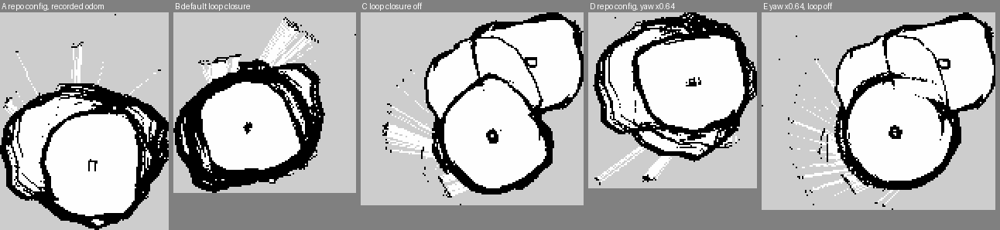

# VESC IMU and the doubled map (2026-11-12)

**There is no IMU data to judge.** Neither 2026-11-12 bag has an IMU topic, and the car image
never asked the VESC for IMU data: `docker/car/patches/vesc_driver-readonly.patch` dropped the
`requestImuData()` poll (2026-10-07), while the driver still creates the publishers. So
`/vesc/sensors/imu` and `/vesc/sensors/imu/raw` show up in `ros2 topic list` and stay silent.
Whether the FSESC 6.7 has an IMU chip at all is unknown from here (the VESC Tool export has
`imu_conf.type = 1`, "internal", which says what the firmware is configured to expect, not that
a chip is fitted). Nothing below measures rates, noise, bias, scale, axes or latency of a gyro,
and nothing was fed to the EKF. No `vehicle_params` fields changed (no schema bump): there is no
measured mount or covariance to put in.

## What this change does

| Change | Why |
|---|---|
| Patch: the IMU poll comes back as a parameter, `poll_imu`, default false | a read request (`COMM_GET_IMU_DATA`, 50 Hz), no set-command, the Dockerfile's no-subscription and no-set checks still apply; compiles against the pinned commit |
| `vesc_telemetry.launch.py` argument `poll_imu`, `car_teleop.launch.py` argument `vesc_imu` (default false) | one flag to turn it on for a measurement run |
| Recorder regex adds `/vesc/sensors/imu` and `/vesc/sensors/imu/raw` | they land in the bag when polling is on; the old test asserted `/vesc/sensors/imu` was NOT recorded |
| `tools/imu_check.py` | one command on a bag gives the verdict and the fit (below) |

The car image has to be rebuilt for the patch to take effect. Then:

```
ros2 launch racer_bringup car_teleop.launch.py vesc:=true vesc_imu:=true ...   # lidar:=true too
uv run python tools/imu_check.py car-data/bags/<bag>      # gyro in deg/s is the default
```

Leave the car still for 30 s at the start (standstill bias and noise), then drive a few slow
laps (scale, sign, lag). Verdicts: `silent` (poll still off), `zeros` (a board without an IMU
answers with zeros), `junk` (flat), `alive`. Only with `alive` is there a `fit_gyro_z`.

Units: the driver publishes gyro in deg/s and accel in g into a `sensor_msgs/Imu` that claims SI
(f1tenth/vesc `vesc_packet.cpp` comments). I left that alone; if the board proves real, convert
at the driver boundary before anything consumes it (invariant 4). Axis and sign against
base_link (REP-103, +z up, left turn positive) come from the fit's sign, and the mount
(`sensors.imu.mount_*`, still null) from a tape measure, then a `vehicle_params` schema bump.
The EKF's `imu0` slot in `ros_ws/src/racer_state/config/ekf.yaml` still points at the ingest
board and is untouched.

## What the bag does say: the wheel yaw rate is too big

`tools/imu_check.py` on `2026-11-12T03-04-56_car_teleop`, `/odom/wheel_twist` yaw rate against
the yaw rate of point-to-point ICP between consecutive 10 Hz scans (`safety_replay/motion.py`),
2585 scan pairs where the car moved faster than 0.3 m/s and ICP rms was under 3 cm (the
gap_follow runs at 201 to 262 s, 298 to 345 s and 1749 to 1923 s of the bag; the car sits
still for most of the rest):

- ICP yaw rate = 0.64 x the modelled yaw rate (regression through the origin), correlation 0.95.
  Put the other way, `v tan(delta) / L` through the servo model overstates the yaw rate by about
  1.56x. Mean residual 0.20 rad/s, std 0.29 rad/s (the stated EKF sigma is 0.02 rad/s).
- By size of the modelled rate: 0.59 below 0.3 rad/s, 0.71 at 0.3 to 0.8, 0.66 at 0.8 to 1.5,
  0.55 above 1.5 (tyre slip grows with the turn).
- Best lag 1 scan period (0.1 s): the modelled rate leads the scan motion. Part of that is the
  scan stamp convention.
- Caveat: on this near-featureless foam oval ICP also reads forward travel at 0.73 x
  `speed * dt`, so ICP under-reads along the lane; the yaw ratio is likely less affected but
  should be taken as "about 0.6 to 0.7", not as a calibration. A real gyro is the way to settle it.

The EKF's yaw is the integral of that rate (the bag's `/odom` yaw is reproduced to 0.17 rad over
the whole bag by integrating `/odom/wheel_twist`), so odom heading drifts about 0.5 rad per
radian turned. slam_toolbox corrects each scan against the previous ones, so this mostly shows
as a poor initial guess and a large accumulated loop error, which is why the loop closure
matters so much below.

## Offline mapping replay

Recorded `/scan` (only the stretches where the car moves, plus 3 s either side: 3505 scans) and an odom to base_link fed to `sync_slam_toolbox_node` on sim time (ros-dev image,
`slam_toolbox.yaml` from this repo unless stated). The odom is the bag's own `/odom`, or the
wheel twist re-integrated with the yaw rate scaled by 0.64 (a stand-in for a gyro that agrees
with the scan matching). One run each; the replay itself is deterministic (the repo-config run
gave the same map twice), but it is one bag and its scan timing is not the live node's.



| | map |
|---|---|
| A repo config (chain 15, responses 0.5 / 0.6), recorded odom | one ring with extra ghost walls on both flanks, thick walls |
| B loop closure at slam_toolbox defaults (chain 10, 0.35 / 0.45), recorded odom | one ring, thick on the left, the tidiest of the five |
| C loop closure off | the track three times over, rotated: the same failure as the live map |
| D repo config, yaw x0.64 | one ring with a second ring offset (partial doubling) |
| E yaw x0.64, loop closure off | the track twice or three times, rotated |

What I take from it, and how far it goes:

- The live doubled map looks like C. Loop closure was not engaging, or closing at the wrong
  place; with it off the odom drift alone produces the rotated copies.
- Fixing the yaw rate alone (D, E) did not remove the doubling or the smear, so a gyro on its own
  would not have saved this map; it makes the odom better, the loop closure still has to fire.
- The repo's strict loop closure (the 2026-11-03 sim tuning, chosen so a lane rectangle did not
  close at the wrong place) gives A, which still has ghost walls; the default thresholds gave B,
  visibly cleaner on this oval. One bag is not enough to overturn a 12-of-12 sim result, so
  `slam_toolbox.yaml` is NOT changed here. Next step: replay the 2026-11-11 oval bags through
  A and B the same way and pick on all of them.
- I did not measure loop closure error or wall thickness numerically in a way I trust (the
  occupied-cell count does not separate "thick" from "duplicated"), so the table is a visual
  call from the picture, not a metric.

## For the PnP dynamics fitting

The measured yaw rate available today is the scan-matched one (`tools/imu_check.py`'s
`icp_yaw_rates`, 10 Hz, noisy, about 0.1 s of stamp ambiguity); `/odom/wheel_twist` yaw is a
model output, not a measurement, and should not be fitted against. If the VESC IMU turns out
`alive`, the signal is `/vesc/sensors/imu/raw` `angular_velocity.z`, 50 Hz when `poll_imu` is
on, in deg/s despite the message type, with the board's own bias (measure it at the start of
every run) and an unknown latency (the driver stamps with `now()` on receipt over a 115200 baud
UART, so expect a few ms to tens of ms; the fit reports it as `best_lag`). Training code is not
touched.
