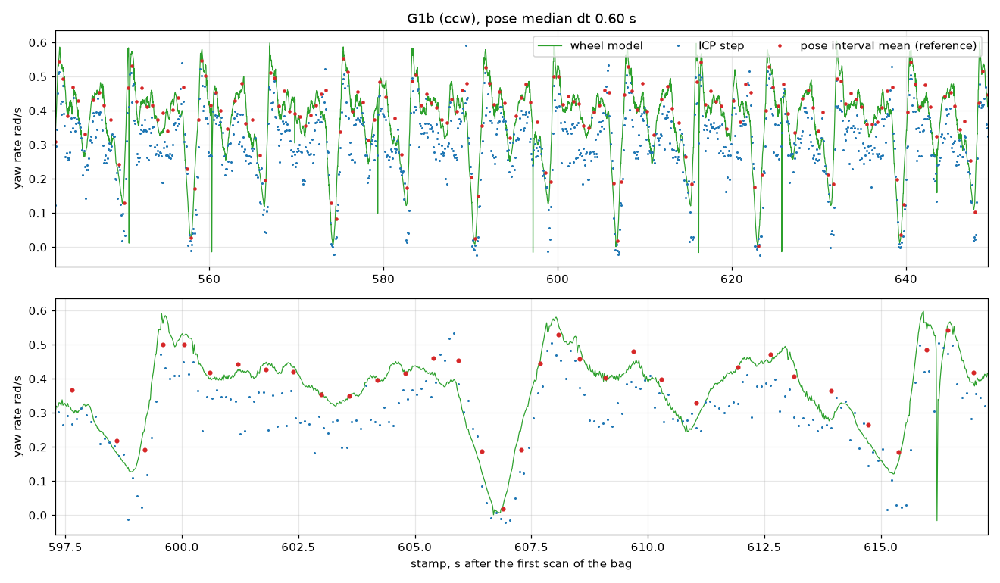
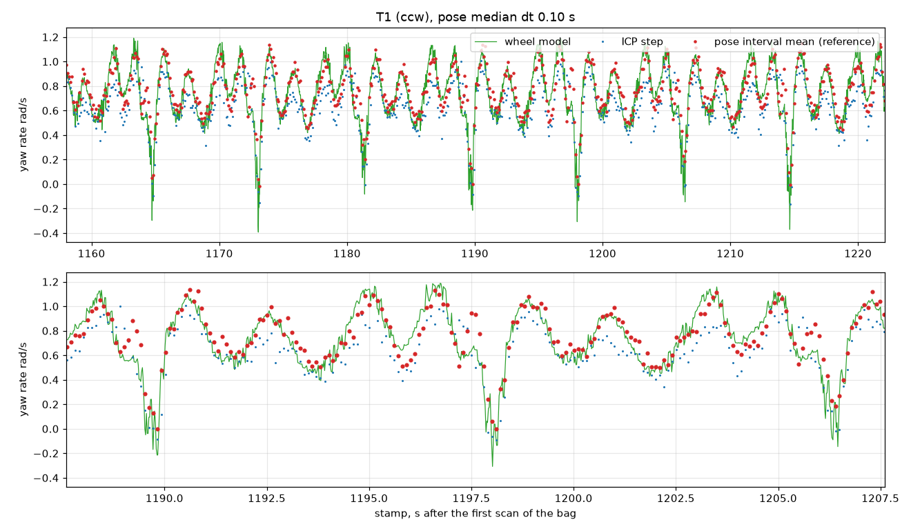
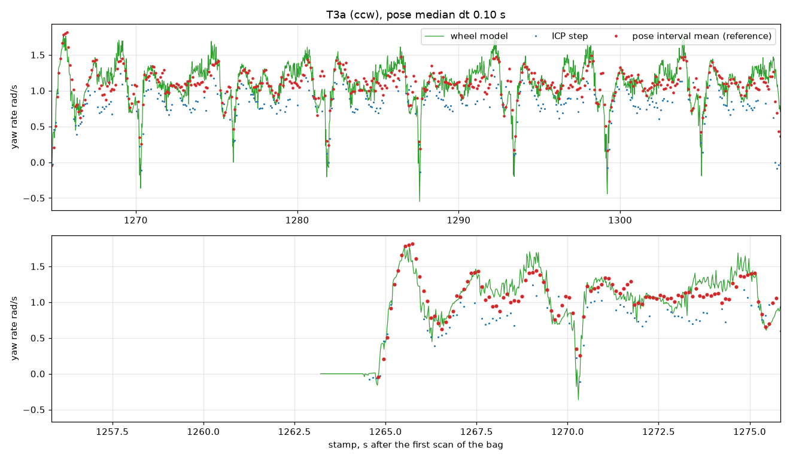

# Yaw rate from scan matching, measured against the map pose (P2.2, 2026-11-13)

A measurement (pre-registration section 3.4), not a gate. Code: `tools/yaw_rate/`, run with
`tools/yaw_rate_eval.py`, tests in `tools/tests/test_yaw_rate.py`. Nothing runs on the car.

## What was measured

The car has no IMU. Reference: the yaw change between consecutive `/pose` messages (slam_toolbox
in bag 22-00-40, AMCL in bag 23-27-23); `/tf` is not independent at 10 Hz. The `/pose` header
stamp equals a scan stamp exactly, so scan-matching yaw integrates over exactly the same
interval. Segments G1a, G1b, T0, T1, T2a, T2b, T3a, T3b of the frozen split. Dropped: intervals
longer than 1.5 s and pose jumps. Signals:

- `icp`: the repo matcher (`tools/safety_replay/motion.py`, point-to-point ICP from the identity,
  car's own static returns masked) with the dynamics package flags (RMS at most 0.02 m, inlier
  share at least 0.7).
- `icp_seeded`: the same matcher and flags, started at the wheel twist's motion over the interval
  (heading change and path from `/odom/wheel_twist`). Added because `icp` under-reads (below).
- `wheel`: `/odom/wheel_twist` `angular.z` (wheel speed, modelled steering, yaw gain table).
- (c), an adopted open-source node, was NOT done: the owner did not approve building a third-party
  scan-matching node.

Conventions: errors are signal minus reference, rad/s. Delay is positive when the signal is late.
Delay is against the pose where the pose stream resolves 10 Hz yaw (median pose interval at most
0.25 s: AMCL segments T0 to T3), otherwise against the steering model `v_wheel tan(delta_cmd) / L`
from the gated `/drive` (G1, G2, G3; includes the steering lag). Correlation `r` and the
`drop` (peak minus mean correlation at +-0.1 s) say how sharp the peak is. Closure noise is the
RMS of (direct match i to i+2 minus the two single steps) divided by 0.2 s; the implied noise of
one 10 Hz step rate is 2/sqrt(3) times that (about 0.032 rad/s for `icp_seeded`).

Two refinements of the written rules, both stated here so they can be vetoed. The jump test
compares the pose chord with the wheel path turned into a chord (`s sinc(dyaw/2)`), because in a
0.83 m radius corner arc and chord differ by more than 0.3 m without any jump. `G2`, `G3a`, `G3b`
(clockwise, have `/pose`) are included as a supplement because the pre-registered list has no
clockwise segment at speed; they are marked below only by being the `cw` rows and do not enter
`ccw`.

## Results (consecutive pose intervals, as pre-registered)

#### Signal: icp

| direction | speed bin m/s | intervals | rejected | bias rad/s | RMS rad/s | closure RMS rad/s | longest rejected run s | delay vs pose s | delay vs steering model s |
|---|---|---|---|---|---|---|---|---|---|
| ccw | 0.25-0.6 | 2214 | 0.0% | -0.098 | 0.120 | 0.047 | 0.1 | +0.046 (r 0.87, drop 0.01, n 1286) | +0.045 (r 0.87, drop 0.02, n 2690) |
| ccw | 0.6-0.85 | 4 | 0.0% | -0.061 | 0.266 | 0.029 | 0.0 | n/a | n/a |
| ccw | 0.85+ | 1301 | 18.8% | -0.167 | 0.215 | 0.063 | 1.0 | +0.015 (r 0.87, drop 0.08, n 1056) | n/a |
| cw | 0.25-0.6 | 192 | 0.0% | 0.084 | 0.215 | 0.041 | 0.0 | n/a | +0.048 (r 0.88, drop 0.02, n 792) |
| cw | 0.85+ | 25 | 24.0% | 0.136 | 0.378 | 0.031 | 0.2 | n/a | +0.075 (r 0.95, drop 0.05, n 149) |
| all | 0.25-0.6 | 2406 | 0.0% | -0.084 | 0.130 | 0.046 | 0.1 | +0.046 (r 0.87, drop 0.01, n 1286) | +0.047 (r 0.98, drop 0.00, n 3481) |
| all | 0.6-0.85 | 4 | 0.0% | -0.061 | 0.266 | 0.031 | 0.0 | n/a | n/a |
| all | 0.85+ | 1326 | 18.9% | -0.162 | 0.219 | 0.056 | 1.0 | +0.015 (r 0.87, drop 0.08, n 1056) | +0.075 (r 0.95, drop 0.05, n 149) |

#### Signal: icp_seeded

| direction | speed bin m/s | intervals | rejected | bias rad/s | RMS rad/s | closure RMS rad/s | longest rejected run s | delay vs pose s | delay vs steering model s |
|---|---|---|---|---|---|---|---|---|---|
| ccw | 0.25-0.6 | 2214 | 0.0% | -0.025 | 0.061 | 0.029 | 0.1 | -0.034 (r 0.92, drop 0.01, n 1286) | +0.035 (r 0.95, drop 0.03, n 2690) |
| ccw | 0.6-0.85 | 4 | 0.0% | -0.009 | 0.260 | 0.021 | 0.0 | n/a | n/a |
| ccw | 0.85+ | 1301 | 2.0% | 0.007 | 0.129 | 0.029 | 0.2 | +0.014 (r 0.93, drop 0.06, n 1275) | n/a |
| cw | 0.25-0.6 | 192 | 0.0% | 0.015 | 0.203 | 0.028 | 0.0 | n/a | +0.032 (r 0.95, drop 0.02, n 792) |
| cw | 0.85+ | 25 | 8.0% | 0.032 | 0.330 | 0.027 | 0.2 | n/a | +0.072 (r 0.97, drop 0.05, n 158) |
| all | 0.25-0.6 | 2406 | 0.0% | -0.022 | 0.082 | 0.029 | 0.1 | -0.034 (r 0.92, drop 0.01, n 1286) | +0.035 (r 0.99, drop 0.00, n 3481) |
| all | 0.6-0.85 | 4 | 0.0% | -0.009 | 0.260 | 0.026 | 0.0 | n/a | n/a |
| all | 0.85+ | 1326 | 2.1% | 0.007 | 0.135 | 0.028 | 0.2 | +0.014 (r 0.93, drop 0.06, n 1275) | +0.072 (r 0.97, drop 0.05, n 158) |

#### Signal: wheel

| direction | speed bin m/s | intervals | rejected | bias rad/s | RMS rad/s | closure RMS rad/s | longest rejected run s | delay vs pose s | delay vs steering model s |
|---|---|---|---|---|---|---|---|---|---|
| ccw | 0.25-0.6 | 2214 | 0.0% | -0.020 | 0.063 | n/a | n/a | -0.023 (r 0.92, drop 0.01, n 1286) | n/a |
| ccw | 0.6-0.85 | 4 | 0.0% | 0.226 | 0.278 | n/a | n/a | n/a | n/a |
| ccw | 0.85+ | 1301 | 0.0% | -0.001 | 0.119 | n/a | n/a | -0.026 (r 0.94, drop 0.07, n 1301) | n/a |
| cw | 0.25-0.6 | 192 | 0.0% | -0.008 | 0.205 | n/a | n/a | n/a | n/a |
| cw | 0.85+ | 25 | 0.0% | -0.025 | 0.349 | n/a | n/a | n/a | n/a |
| all | 0.25-0.6 | 2406 | 0.0% | -0.019 | 0.084 | n/a | n/a | -0.023 (r 0.92, drop 0.01, n 1286) | n/a |
| all | 0.6-0.85 | 4 | 0.0% | 0.226 | 0.278 | n/a | n/a | n/a | n/a |
| all | 0.85+ | 1326 | 0.0% | -0.001 | 0.127 | n/a | n/a | -0.026 (r 0.94, drop 0.07, n 1301) | n/a |

#### Drops (pose intervals)

| segment | intervals | longer than 1.5 s | pose jump | kept | median pose dt s |
|---|---|---|---|---|---|
| G1a | 744 | 0 | 0 | 744 | 0.596 |
| G1b | 185 | 0 | 0 | 185 | 0.596 |
| T0 | 1285 | 0 | 0 | 1285 | 0.199 |
| T1 | 642 | 0 | 0 | 642 | 0.100 |
| T2a | 126 | 0 | 0 | 126 | 0.100 |
| T2b | 87 | 0 | 0 | 87 | 0.100 |
| T3a | 452 | 0 | 0 | 452 | 0.100 |
| T3b | 0 | 0 | 0 | 0 | n/a |
| G2 | 205 | 9 | 3 | 193 | 0.695 |
| G3a | 18 | 2 | 3 | 13 | 0.910 |
| G3b | 14 | 1 | 1 | 12 | 1.008 |

#### Verdicts (0.85 m/s and above, directions pooled)

- icp: not usable for adaptation ({'rms_error': False, 'closure_noise': True, 'delay': True})
- icp_seeded: not usable for adaptation ({'rms_error': False, 'closure_noise': True, 'delay': True})
- wheel: not usable for adaptation ({'rms_error': False, 'delay': True})

`T3b` has no `/pose` messages at all (AMCL published nothing in that window), so it
contributes nothing. The 0.6 to 0.85 bin has 4 intervals: the car drove 0.5 or 1.0 m/s and
above. The cw 0.85+ rows are 25 intervals from the clockwise race run only.

CPU of `scan_motion` per scan pair, numpy single thread on this Mac: median 0.270 s, p90 0.299 s
(n 200). The machine was loaded by other jobs (load average above 40), so read it as an upper
bound. It is brute-force nearest neighbours, 40 iterations, not a car-side implementation.

Plots (reference, ICP steps, wheel model against time; all eleven are in the run output
`car-data/pnp/yaw_rate/consecutive/plots`):

## Verdicts (pre-registered rule, 0.85 m/s and above, directions pooled)

- `icp`: not usable for adaptation. RMS 0.219 rad/s (limit 0.10); closure 0.056 and delay
  +0.015 s pass. It under-reads: bias -0.162 rad/s, regression slope about 0.86 on T1.
- `icp_seeded`: not usable for adaptation. RMS 0.135 rad/s; closure 0.028 and delay +0.014 s pass.
  Bias +0.007 rad/s.
- `wheel`: not usable for adaptation. RMS 0.127 rad/s; delay -0.026 s passes (no closure for a
  model signal, judged on RMS and delay).

## Sensitivity to the reference (not a relabel)

The reference is itself noisy: AMCL pose at 0.1 s intervals. The wheel model, which is smooth
and unbiased here (bias -0.001), has RMS 0.127 against it, so a floor of order 0.1 rad/s
comes from the reference. Merging consecutive `/pose` messages to a minimum interval (the
`--min-interval-s` option, `car-data/pnp/yaw_rate/merged_*`), pooled over directions, 0.85+:

| min interval | `icp` RMS | `icp_seeded` RMS | `wheel` RMS | verdict by the rule |
|---|---|---|---|---|
| consecutive (0.1 s AMCL, 0.6 s slam) | 0.219 | 0.135 | 0.127 | none usable |
| 0.5 s | 0.196 | 0.108 | 0.123 | none usable |
| 1.0 s | 0.141 | 0.060 | 0.083 | `icp_seeded` and `wheel` usable, `icp` not |

(ccw only at 0.5 s: 0.179, 0.087, 0.106.) The pre-registered verdict is the first row. The
other rows only show that the 0.10 limit cannot be separated from reference noise at 0.1 s.

## What it means for P2.4

- By the pre-registered rule no signal qualifies, so the limit in design section 5.B stands:
  grip adaptation is weakly observable until a faster or better-referenced yaw signal exists.
- Plain ICP from the identity must not be used: it systematically under-reads yaw by about 12 to
  14 percent at 1 m/s and above and rejects 19 percent of intervals at 0.85+. The dynamics fit takes
  ground speed from this matcher (`icp_motion.py`); whether its translation under-reads the same
  way was not measured here and is worth a check.
- If the adaptation module wants a scan-based yaw, read the wheel-seeded matcher: bias near
  zero, closure noise 0.028 rad/s (one 10 Hz step about 0.032 rad/s), delay within +-0.03 s of the
  pose (the matched yaw is at scan stamp time), 2 percent of intervals rejected with runs of at most 0.2 s at
  0.85+ (coast on the wheel yaw through those). Rate 10 Hz, no delay compensation beyond the scan
  stamp; against the steering model the lag is +0.035 to +0.072 s, which is mostly the steering
  lag, not the signal.
- What this measurement cannot say: whether the seeded matcher carries information the wheel
  model lacks (slip). Both have the same RMS against the 0.1 s reference. The test that matters is
  the difference seeded minus wheel during slip at 1.5 to 2.0 m/s; it was not run here.

## Recommendation on adopting a node (the owner decides)

Nothing third-party was built or run, so image size and CPU are not measured.

| Option | Licence | Cost |
|---|---|---|
| `rf2o_laser_odometry`, ROS 2 port | GPL-3.0 (the fork checked on GitHub; the original is MRPT-derived) | small C++ package, laser only, expected millisecond CPU; adds a GPL component to the car image; needs its own launch and a TF/odom source decision |
| `ros2_laser_scan_matcher` (CSM based) | no licence file shown on the ROS 2 port | small; legal status unclear until the author states one |
| No node: seeded matcher in C++ inside our own tree | ours | violates "adopt, do not write" for the car; costs a C++ ICP and its tests |
| No node: keep the wheel model | ours | free; accepts the known limit of section 5.B |

Suggested order of evidence before choosing: run option 1 on the same bags (needs the owner's
approval to build it in a scratch container), compare against `icp_seeded` on the slip stretches,
then decide.
